# Digital Launch Reliability Platform

[](https://github.com/gkoufie1/digital-launch-reliability-platform/actions/workflows/ci.yml)


A production-style AWS platform for a fictional game launch ("Operation: Starfall"), built to practise what keeps a site up on launch day: **infrastructure as code, zero-downtime deploys, automatic rollback, autoscaling, observability and security by default**.

The application is intentionally small: a Next.js site with a health endpoint. The engineering is in everything around it, from the network and the container platform to the delivery pipeline and the monitoring.

> **Status:** Phase 1 complete. On 2026-10-19 the AWS environment was deployed (45 resources in 6 minutes), verified, captured in the screenshots below, and destroyed (47 resources removed in 4 minutes, with a teardown check confirming nothing billable was left). It ran for **about 70 minutes at a cost of roughly $0.15**. It is a temporary environment by design and can be rebuilt from this repository in about 10 minutes.

---

## What this project demonstrates

| Area | Implementation |
|---|---|
| **Infrastructure as code** | Terraform with 5 reusable modules, remote state in S3 with native locking, and a full build/destroy lifecycle |
| **Containers** | Multi-stage Docker build, non-root runtime user, immutable versioned images in ECR |
| **High availability** | Two Availability Zones, a load balancer that health-checks every task, and a service that replaces failed tasks |
| **Safe delivery** | Rolling deploys with no downtime, plus a deployment circuit breaker that **automatically rolls back** a bad release |
| **Scalability** | Autoscaling from 2 to 4 tasks on CPU usage or requests per task |
| **Observability** | CloudWatch dashboard, alarms emailed via SNS, centralised logs, Container Insights |
| **Security** | Private subnets with no public IPs, least-privilege IAM, image vulnerability scanning, Checkov policy scanning |
| **CI and supply chain** | GitHub Actions with SHA-pinned actions, a read-only token, a Docker smoke test, Dependabot, and SonarCloud |
| **Cost awareness** | About $0.12/hour while running, documented trade-offs, and nothing left running between sessions |

---

## Architecture

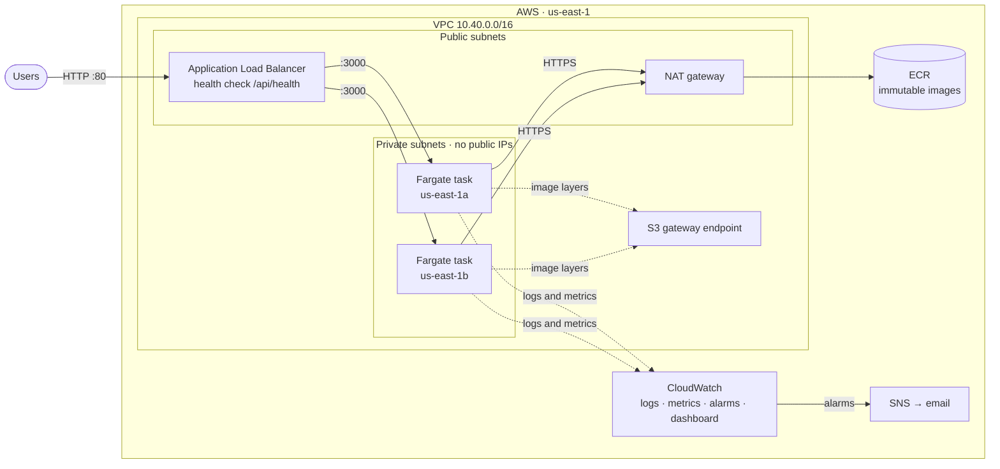

**How a request flows:** the load balancer in the public subnets receives traffic and forwards it only to tasks that pass the `/api/health` check. The tasks run in private subnets with no public IP, so they can't be reached directly from the internet. Their only outbound traffic is HTTPS through the NAT gateway, to pull images and send logs. Image layers come through a free S3 gateway endpoint instead of the NAT gateway, which avoids NAT data charges.

The full module breakdown and the build/destroy runbook are in [infra/README.md](infra/README.md).

---

## The platform running on AWS

Captured from the live deployment of image `c8b0e03` on 2026-10-19. Account IDs and resource identifiers are redacted.

### The application, served from AWS

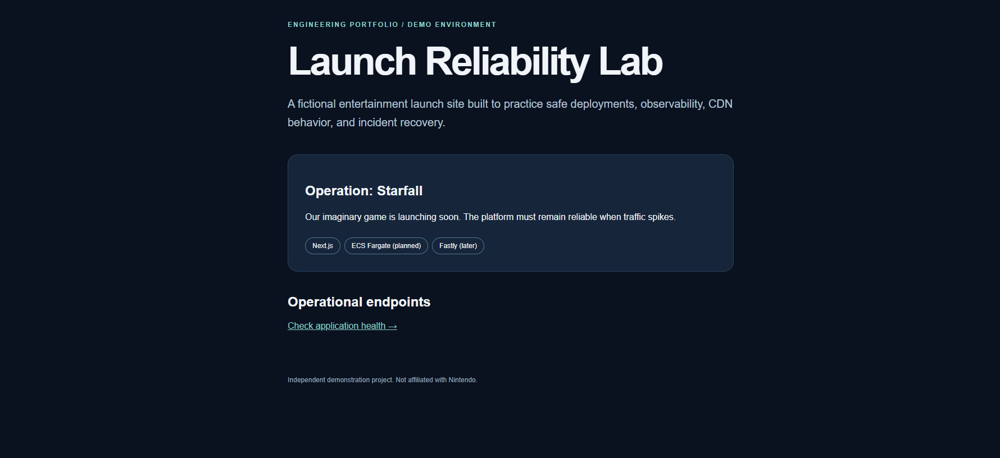

The Next.js site served through the Application Load Balancer from containers on ECS Fargate.

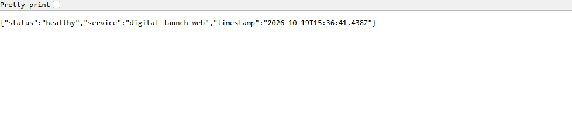

**`/api/health`** is the endpoint the load balancer and ECS use to decide whether a task can receive traffic. It responds with `Cache-Control: no-store`, so a CDN added later can never serve a stale "healthy" result.

### Compute: ECS Fargate

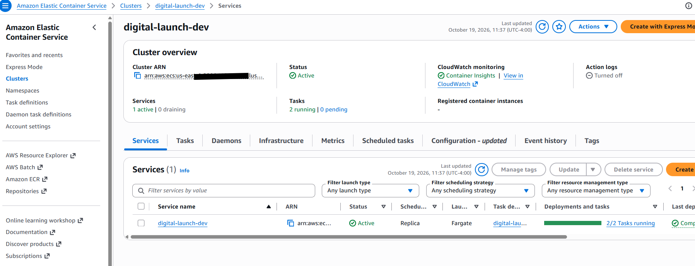

**The ECS cluster:** one service, **2/2 tasks running**, and Container Insights enabled. Fargate means there are no servers to patch; AWS runs the containers.

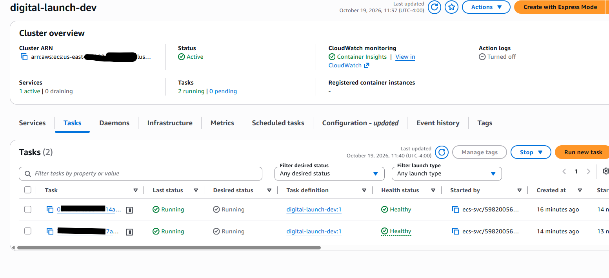

**Both tasks are Running and Healthy.** "Healthy" comes from the container's own health check, in addition to the load balancer's check. If either check fails, ECS replaces the task automatically.

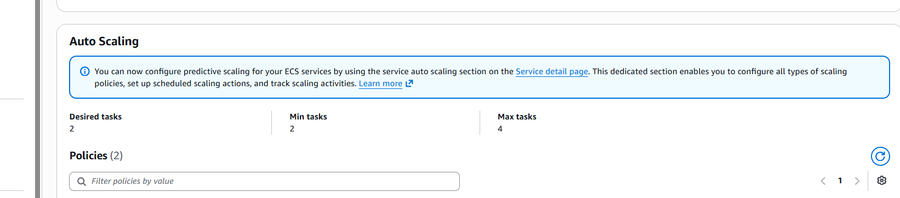

**Autoscaling:** the service keeps at least 2 tasks (one per AZ) and can grow to 4. Two target-tracking policies scale out on **CPU above 60%** or **more than 1,000 requests per task per minute**, so a launch-day spike adds capacity before users notice.

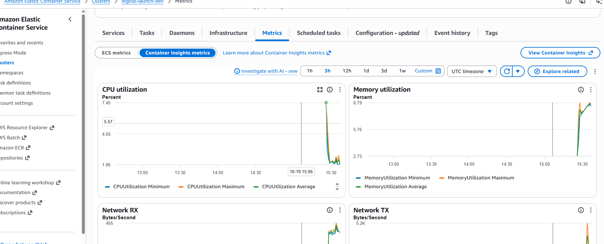

**Container Insights:** CPU, memory and network per task. The spike on the right is the service starting and taking its first traffic. At idle, each task uses about 2% CPU and 9% memory, so the 0.25 vCPU / 0.5 GB task size has plenty of headroom.

### Traffic: Application Load Balancer

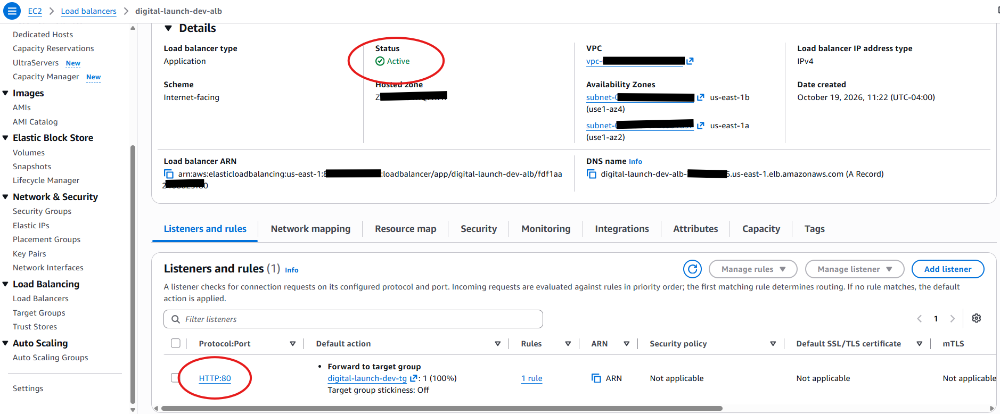

**The load balancer** is Active and internet-facing, deployed across **two Availability Zones** (`us-east-1a` and `us-east-1b`), with an HTTP:80 listener forwarding to the target group. HTTPS is deliberately left for the CDN phase (see [Design decisions](#design-decisions-and-trade-offs)).

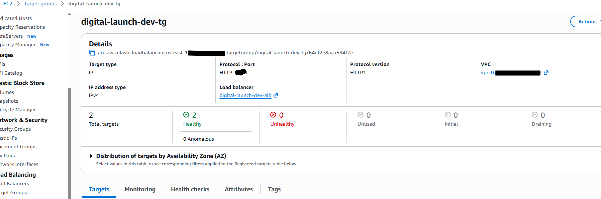

**Target health: 2 healthy, 0 unhealthy.** The load balancer checks every task every 15 seconds and sends traffic only to tasks that pass. New tasks must be healthy here before a deployment removes the old ones, which is what makes deploys zero-downtime.

### Images and supply chain: ECR

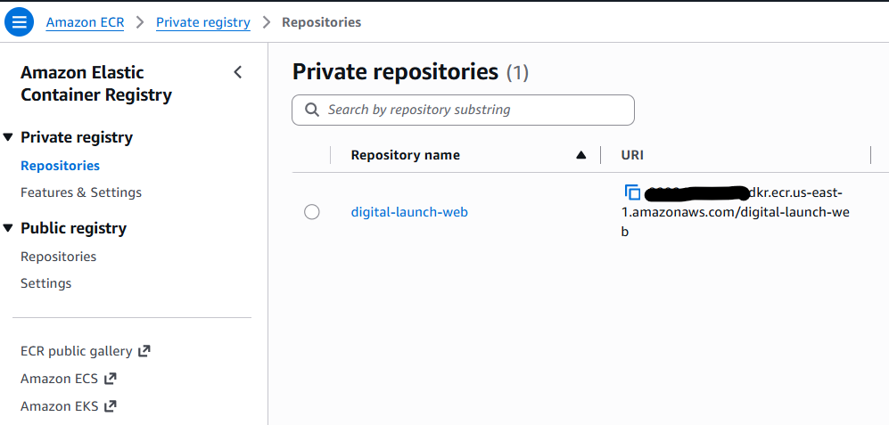

**The private image registry.** Tags are **immutable**: once `c8b0e03` is pushed, that tag can never point at different code. Every deployment can be traced to an exact git commit, and `latest` is rejected by Terraform validation.

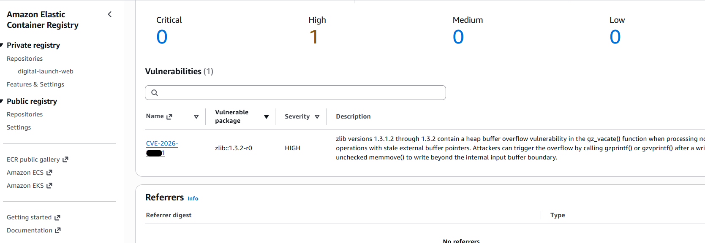

**Vulnerability scanning on every push** found **one HIGH finding** in `zlib`, inherited from the Alpine base image rather than the application code. The finding is tracked; the fix is to rebuild on patched Alpine packages and confirm a clean rescan.

### Observability: CloudWatch

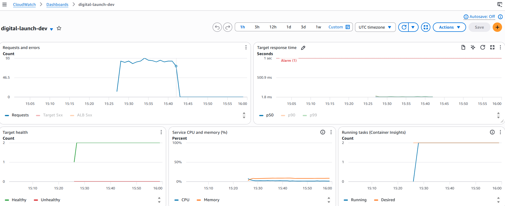

**The operations dashboard**, defined in Terraform, on one screen:
- **Requests and errors:** steady traffic of about 90 requests per minute during testing, with **zero 5xx errors**.
- **Target response time:** responses in **a few milliseconds**, far below the 1-second alarm line (dashed red).
- **Target health:** 2 healthy, 0 unhealthy, from the moment the service started.
- **CPU and memory:** low and flat.
- **Running tasks:** running matches desired (2/2) throughout.

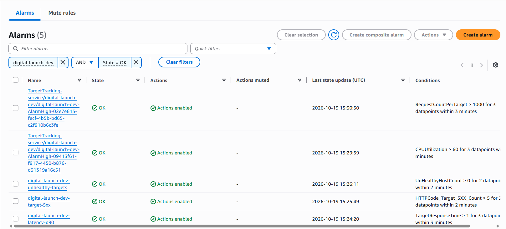

**Alarms, all OK.** Three project alarms cover what users would notice: **5xx errors**, **unhealthy targets** and **p90 latency above 1 second**. They notify an SNS topic that sends email. The two `TargetTracking` alarms are created by autoscaling to trigger scale-out.

---

## Design decisions and trade-offs

| Decision | Why | Trade-off |
|---|---|---|
| **One NAT gateway** instead of one per AZ | Saves ~$33/month per extra gateway | If `us-east-1a` fails, tasks in `us-east-1b` lose outbound internet. Set `single_nat_gateway = false` for full AZ independence. |
| **HTTP only** on the load balancer | HTTPS needs a domain and certificate, which arrive with the Fastly CDN phase | Fine for a temporary demo; not acceptable for real users |
| **Fargate** rather than EC2 or EKS | No servers or cluster to manage; billed per second | Less control over the host than EC2, and a higher per-vCPU price |
| **Scoped IAM policy** rather than the AWS managed policy | Tasks can pull from **one** repository and write to **one** log group | More policy to maintain |
| **Immutable tags** set to the git SHA | Every running container traces to an exact commit | A new commit is needed for every deploy |
| **Temporary environment** | Build, verify, document, destroy: pay only for hours used | Not continuously available; rebuilding takes about 10 minutes |
| **16 Checkov findings accepted** | Each is justified inline with `#checkov:skip`: HTTPS/TLS, WAF, KMS customer keys, deletion protection, long log retention | Each is a known, documented gap rather than an unnoticed one |

---

## CI/CD and quality gates

Every pull request and every push to `main` runs [`.github/workflows/ci.yml`](.github/workflows/ci.yml):

1. **Verify:** `npm ci --ignore-scripts` → lint → typecheck → production build → `npm audit` for production dependencies.
2. **Container:** builds the Docker image, starts it, and smoke-tests that `/api/health` returns 200 with `status: healthy` and `Cache-Control: no-store`, that the home page loads, and that the container runs as the non-root `node` user.
3. **SonarCloud** code analysis and quality gate.

**Supply-chain hardening:** actions are pinned to full commit SHAs, the workflow token is read-only, and dependency install scripts are disabled. Dependabot proposes weekly updates, but major version jumps of core tooling are reviewed by hand. CI earned its keep immediately: it blocked a Dependabot update that would have moved TypeScript from 5 to 7 and broken the lint toolchain.

---

## Repository structure

```
.
├── src/app/                 Next.js app (page and /api/health)
├── Dockerfile               Multi-stage build, non-root runtime
├── .github/
│   ├── workflows/ci.yml     CI pipeline
│   └── dependabot.yml       Automated dependency updates
├── infra/
│   ├── bootstrap/           S3 bucket for Terraform state
│   ├── modules/
│   │   ├── network/         VPC, subnets, NAT, S3 endpoint
│   │   ├── ecr/             Image repository and lifecycle
│   │   ├── alb/             Load balancer, target group, listener
│   │   ├── ecs/             Cluster, service, IAM, autoscaling
│   │   └── monitoring/      Dashboard, alarms, SNS
│   ├── envs/dev/            The dev environment, wiring the modules
│   └── README.md            Runbook: build, deploy, destroy
├── scripts/push-image.sh    Build and push an image tagged with the git SHA
└── docs/
    ├── ARCHITECTURE-PLAN.md
    ├── SCREENSHOTS.md       Capture checklist
    └── screenshots/
```

---

## Run it

**Locally** (Node.js 22.13+):
```bash
npm ci
npm run dev                  # http://localhost:3000
```

**In Docker:**
```bash
docker build -t digital-launch-web:local .
docker run --rm -p 3000:3000 digital-launch-web:local
curl -i http://localhost:3000/api/health
```

**On AWS:** see the step-by-step runbook in [infra/README.md](infra/README.md). In short:
```bash
export AWS_PROFILE=<your-profile>
TAG=$(git rev-parse --short HEAD)
terraform -chdir=infra/envs/dev apply -target=module.ecr -var image_tag=$TAG
scripts/push-image.sh $TAG
terraform -chdir=infra/envs/dev apply -var image_tag=$TAG     # ~6–10 minutes
terraform -chdir=infra/envs/dev destroy -var image_tag=$TAG   # when you're done
```

> **Cost:** about $0.12/hour while running (load balancer, NAT gateway, 2 Fargate tasks, public IPv4 addresses). The first full session, from build through screenshots to destroy, ran about 70 minutes and cost roughly $0.15. Always run `destroy` at the end of a session.

---

## Roadmap

- [x] **Phase 1:** Next.js app, Docker, CI, and Terraform for VPC, ALB, ECS Fargate, ECR and CloudWatch, deployed and verified
- [ ] **Deployments from GitHub Actions** via OIDC, with no long-lived AWS keys
- [ ] **Incident drills,** each with a write-up:
  - traffic surge (k6 load test → autoscaling)
  - broken release (circuit breaker → automatic rollback)
  - task failure (ECS self-healing)
- [ ] **Patch the base-image CVE** and verify with a clean rescan
- [ ] **Sentry** error tracking and SLO dashboards
- [ ] **Fastly CDN** with HTTPS, cache purging, and origin protection for the load balancer

---

*Independent portfolio project. "Operation: Starfall" and the launch content are fictional.*
